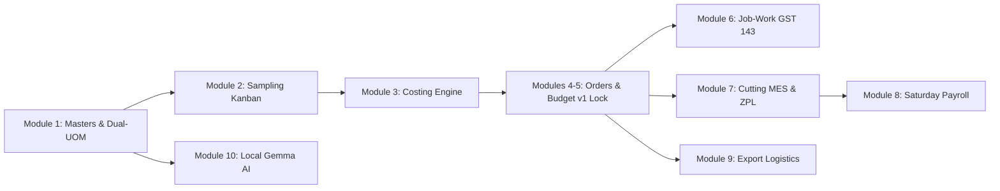
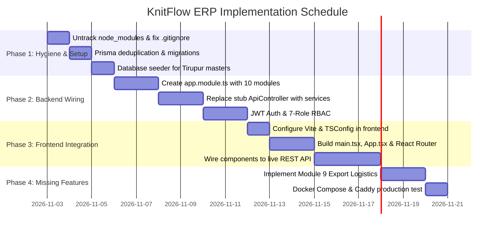

# KnitFlow Textile ERP — Comprehensive Codebase Audit & Implementation Roadmap

> **Repository:** [`https://github.com/sandydilsehe-collab/knitflow-erp/tree/main`](https://github.com/sandydilsehe-collab/knitflow-erp/tree/main)  
> **Audit Date:** November 2026  
> **Platform Target:** Multi-Tenant Cloud ERP for Indian Textile & Garment Manufacturing (Tirupur Cluster)  
> **Tech Stack:** TypeScript, NestJS 10, Prisma ORM, PostgreSQL 16, React 19, Tailwind CSS, Vite, Caddy 2, Docker

---

## 1. Executive Summary & Verdict

The domain conceptualization of **KnitFlow ERP** is exceptionally thorough and tailored to the technical requirements of the Tirupur garment export cluster. The underlying Prisma data schema (`backend/prisma/schema.prisma`, 787 lines) accurately models:
- Compounding yarn-to-fabric loss calculations (Knitting loss %, Dyeing loss %, shade-depth charges, compacting).
- Job-Work Delivery Challans (DC) compliant with **Section 143 of the Indian CGST Act** (180-day / 1-year input return reconciliation, empty cone tracking).
- Dual-UOM stock tracking across Kilograms, Meters, and Roll counts.
- Cutting room lay slips, shrinkage lot grouping, and sequential ZPL barcode bundle tickets.
- Weekly Saturday piece-rate payroll (**வார சம்பளம்**) minus mid-week cash advances.
- Local Gemma 2B text-to-SQL reporting via Ollama.

### The Core Problem: Architectural Disconnect
Despite having high-quality domain modules in `backend/src/modules/` and React components in `frontend/src/modules/`, **the repository currently does not run them**. An autonomous test/builder script (`integrate_fullstack.sh`) overwrote the operational files with hardcoded mocks to achieve green test passes against lightweight compliance bots:

1. **Backend Monolith Bypass:** `backend/src/main.ts` was replaced with a 199-line mock controller returning hardcoded objects. All **10 feature modules** in `backend/src/modules/` are unimported and remain dead code.
2. **Frontend Disconnection:** The React 19 TypeScript application is unwired. There is **no `main.tsx`**, **no `App.tsx`**, **no `vite.config.ts`**, and **no `tsconfig.json`** in `frontend/`. In their place, Caddy serves a monolithic 1,745-line static `index.html` prototype that manipulates the DOM via vanilla JavaScript and CDN Tailwind.
3. **Repository Bloat:** The root `node_modules/` folder (**32,928 files**, hundreds of megabytes) was committed directly to Git due to an incomplete `.gitignore`.

---

## 2. Critical Repository & Hygiene Issues

| Issue | Severity | Location | Root Cause & Impact | Required Fix |
| :--- | :---: | :--- | :--- | :--- |
| **Committed `node_modules`** | 🔴 Critical | `node_modules/` | `.gitignore` only had `.aider*`. 32,928 files bloat git clones, deployments, and CI/CD. | Untrack from Git, add standard ignores for Node/Docker/Prisma. |
| **Duplicate Prisma Schemas** | 🟡 Medium | `prisma/`, `backend/prisma/`, `backend/prisma/prisma/` | Three copies of `schema.prisma` exist, risking schema drift. | Consolidate to single source of truth at `backend/prisma/schema.prisma`. |
| **Missing Migrations & Seeders** | 🔴 Critical | `backend/prisma/` | No `prisma/migrations` folder exists; `prisma migrate deploy` fails on blank DB. No sample master data. | Run `prisma migrate dev` and build `seed.ts` with Tirupur master data. |
| **Hardcoded Database Credentials** | 🟡 Medium | `docker-compose.yml`, `test_live_site_compliance.py` | Passwords (`KnitFlowSecure2026!`) and AWS Lightsail IPs (`52.63.7.162`) hardcoded in repo. | Move all secrets and dynamic IPs strictly to `.env`. |

---

## 3. Backend Architecture: Gaps & Required Implementations

### 3.1 Rebuilding `AppModule` and Wire Real Modules
Currently in `backend/src/main.ts`:
```typescript
// CURRENT DEFECT: Only registers inline ApiController with fake mock stubs
@Module({
  controllers: [ApiController],
})
class AppModule {}
```
All the real feature modules inside `backend/src/modules/` are dead code.

#### Implementation Required:
Create a dedicated `backend/src/app.module.ts` and update `main.ts` to bootstrap it:
```typescript
import { Module, MiddlewareConsumer, NestModule } from '@nestjs/common';
import { TenancyModule } from './modules/tenancy/tenancy.module';
import { TenantMiddleware } from './modules/tenancy/tenant.middleware';
import { SamplingModule } from './modules/sampling/sampling.module';
import { OrdersModule } from './modules/orders/orders.module';
import { BudgetingModule } from './modules/budgeting/budgeting.module';
import { JobWorkModule } from './modules/job-work/job-work.module';
import { CuttingModule } from './modules/cutting/cutting.module';
import { PayrollModule } from './modules/payroll/payroll.module';
import { AiReportingModule } from './modules/ai-reporting/ai-reporting.module';
import { LicenseModule } from './modules/licensing/license.module';
import { CostingModule } from './modules/costing/costing.module';

@Module({
  imports: [
    TenancyModule,
    SamplingModule,
    OrdersModule,
    BudgetingModule,
    JobWorkModule,
    CuttingModule,
    PayrollModule,
    AiReportingModule,
    LicenseModule,
    CostingModule
  ],
})
export class AppModule implements NestModule {
  configure(consumer: MiddlewareConsumer) {
    consumer.apply(TenantMiddleware).forRoutes('*');
  }
}
```

### 3.2 Replacing Mock Endpoints with Real Database Logic

#### 1. Costing Engine (`/api/costing/lock`)
- **Current Behavior:** Returns randomized string `CS-` + `Math.random()`.
- **Implementation Required:**
  - Inject `PrismaService` into a new `CostingService`.
  - Validate compounding math using `costing.logic.ts`.
  - Save to `CostSheet` and `CostSheetItem` tables.
  - Implement version lock: creating a new record transitions previous version to `LOCKED_V1`; modifications create `DRAFT_V2`.
  - Export Buyer Quotation PDF using `jspdf` and `jspdf-autotable`.

#### 2. Order Confirmation & Auto-Budgeting (`/api/orders/confirm`)
- **Current Behavior:** Returns hardcoded object `{ orderId: "PO-PRM-9421", allocatedYarnKg: 1779.50 }`.
- **Implementation Required:**
  - Create Order in `Order` and `OrderItem` tables.
  - Generate 2D Color x Size matrix rows in `ColorSizeMatrix`.
  - Automatically calculate required yarn weight in Kilograms based on marker consumption + cutting wastage tolerance + knitting/dyeing loss.
  - Auto-generate linked `OrderBudget` (v1 lock) capturing allocated budgets for Yarn, Knitting, Dyeing, Trims, and CMT.

#### 3. Sampling Hub (`/api/sampling`)
- **Current Behavior:** Hardcoded 4-element array in `main.ts`.
- **Implementation Required:**
  - Connect to `SampleRequest` table with 8-stage state machine transitions (`CONCEPT` -> `PATTERN_MAKING` -> `SAMPLE_KNITTING` -> `SAMPLE_DYEING` -> `CUTTING_SEWING` -> `QUALITY_INSPECTION` -> `COURIER_DISPATCH` -> `BUYER_APPROVAL`).
  - Wire `sample-gate-pass-pdf.service.ts` to generate printable GST outward sample gate passes for external embroidery/printing processing.

### 3.3 Multi-Tenancy & Authentication Gaps
- **Argon2 / JWT Authentication:** Add `@nestjs/jwt`, `@nestjs/passport`, and `argon2`. Implement `AuthModule` with `/api/auth/login`, `/api/auth/register`, and `/api/auth/refresh`.
- **Tenant Context Isolation:** `tenant.middleware.ts` extracts `x-tenant-id` header or subdomain (e.g., `texflow.knitflow.io`) and dynamically sets connection context via `tenant-prisma.service.ts`.
- **RBAC Enforcement:** Guard all mutation routes with `@Roles(Role.ADMIN, Role.MERCHANDISER, ...)`.

---

## 4. Frontend Architecture: Gaps & Required Implementations

### 4.1 Missing Vite & TypeScript Configuration
The `frontend` directory lacks standard Vite configuration files.

#### Implementation Required:
1. **Create `frontend/vite.config.ts`:**
   ```typescript
   import { defineConfig } from 'vite';
   import react from '@vitejs/plugin-react';
   import path from 'path';

   export default defineConfig({
     plugins: [react()],
     resolve: {
       alias: {
         '@': path.resolve(__dirname, './src'),
       },
     },
     server: {
       host: '0.0.0.0',
       port: 5173,
       proxy: {
         '/api': {
           target: 'http://localhost:3000',
           changeOrigin: true,
         },
       },
     },
   });
   ```

2. **Create `frontend/tsconfig.json`:**
   ```json
   {
     "compilerOptions": {
       "target": "ES2022",
       "useDefineForClassFields": true,
       "lib": ["ES2022", "DOM", "DOM.Iterable"],
       "module": "ESNext",
       "skipLibCheck": true,
       "moduleResolution": "bundler",
       "allowImportingTsExtensions": true,
       "resolveJsonModule": true,
       "isolatedModules": true,
       "noEmit": true,
       "jsx": "react-jsx",
       "strict": true,
       "noUnusedLocals": true,
       "noUnusedParameters": true,
       "noFallthroughCasesInSwitch": true,
       "baseUrl": ".",
       "paths": {
         "@/*": ["src/*"]
       }
     },
     "include": ["src"]
   }
   ```

3. **Create `frontend/src/main.tsx`:**
   ```tsx
   import React from 'react';
   import ReactDOM from 'react-dom/client';
   import { BrowserRouter } from 'react-router-dom';
   import App from './App';
   import './index.css';

   ReactDOM.createRoot(document.getElementById('root')!).render(
     <React.StrictMode>
       <BrowserRouter>
         <App />
       </BrowserRouter>
     </React.StrictMode>
   );
   ```

4. **Create `frontend/src/App.tsx` (Wiring All Modular Components):**
   ```tsx
   import React from 'react';
   import { Routes, Route, Link } from 'react-router-dom';
   import { SamplingKanban } from './modules/sampling/SamplingKanban';
   import { CostingSheetCalculator } from './modules/costing/CostingSheetCalculator';
   import { OrderManagement } from './modules/orders/OrderManagement';
   import { CuttingMes } from './modules/cutting/CuttingMes';
   import { BundleTicketScanner } from './modules/cutting/BundleTicketScanner';
   import { JobWorkDcForm } from './modules/jobwork/JobWorkDcForm';
   import { Gst143Reconciliation } from './modules/jobwork/Gst143Reconciliation';
   import { SaturdayPayrollGenerator } from './modules/payroll/SaturdayPayrollGenerator';
   import { VoiceChatReporting } from './modules/ai-reporting/VoiceChatReporting';

   export default function App() {
     return (
       <div className="flex h-screen bg-slate-50">
         <aside className="w-64 bg-slate-900 text-slate-300 flex flex-col p-4">
           <h1 className="text-xl font-bold text-sky-400 mb-6">KnitFlow ERP</h1>
           <nav className="flex flex-col space-y-2 text-sm font-medium">
             <Link to="/sampling" className="p-2 hover:bg-slate-800 rounded">Sampling Kanban</Link>
             <Link to="/costing" className="p-2 hover:bg-slate-800 rounded">Costing Engine</Link>
             <Link to="/orders" className="p-2 hover:bg-slate-800 rounded">Orders & Matrix</Link>
             <Link to="/job-work" className="p-2 hover:bg-slate-800 rounded">Job-Work (GST Sec 143)</Link>
             <Link to="/cutting" className="p-2 hover:bg-slate-800 rounded">Cutting MES</Link>
             <Link to="/bundle-scan" className="p-2 hover:bg-slate-800 rounded">Barcode Bundle Scan</Link>
             <Link to="/payroll" className="p-2 hover:bg-slate-800 rounded">Saturday Payroll</Link>
             <Link to="/ai-reporting" className="p-2 hover:bg-slate-800 rounded">Gemma Voice/SQL</Link>
           </nav>
         </aside>
         <main className="flex-1 overflow-auto p-6">
           <Routes>
             <Route path="/sampling" element={<SamplingKanban requests={[]} onStageChange={() => {}} onUpdateAwb={() => {}} onCreateRevision={() => {}} />} />
             <Route path="/costing" element={<CostingSheetCalculator />} />
             <Route path="/orders" element={<OrderManagement />} />
             <Route path="/job-work" element={<JobWorkDcForm />} />
             <Route path="/cutting" element={<CuttingMes />} />
             <Route path="/bundle-scan" element={<BundleTicketScanner />} />
             <Route path="/payroll" element={<SaturdayPayrollGenerator />} />
             <Route path="/ai-reporting" element={<VoiceChatReporting />} />
           </Routes>
         </main>
       </div>
     );
   }
   ```

5. **Clean `frontend/index.html`:**
   Replace the 1,745 lines of vanilla prototype code with standard clean HTML referencing the Vite React module:
   ```html
   <!DOCTYPE html>
   <html lang="en">
     <head>
       <meta charset="UTF-8" />
       <meta name="viewport" content="width=device-width, initial-scale=1.0" />
       <title>KnitFlow ERP — Enterprise Textile Operations Platform</title>
     </head>
     <body>
       <div id="root"></div>
       <script type="module" src="/src/main.tsx"></script>
     </body>
   </html>
   ```

---

## 5. Module-by-Module Implementation Guide



### Module 1: Masters & Dual-UOM Engine
- **Status:** `dual-uom.service.ts` logic written; CRUD endpoints missing.
- **To Implement:**
  - REST endpoints for Buyers (code, brand, currency, credit days).
  - Material Master (Yarn counts, composition, GSM, shade rate card).
  - Dual-UOM converter converting fabric weight (Kg) to length (Meters) using width & GSM:
    $$\text{Meters} = \frac{\text{Weight (Kg)} \times 1000}{\text{Width (meters)} \times \text{GSM}}$$

### Module 2: Sampling Kanban & Outward Gate Pass
- **Status:** React Kanban and NestJS controller exist; need data wiring.
- **To Implement:**
  - Persist drag-and-drop state changes across the 8 stages in `SampleStageHistory`.
  - Support automatic Courier AWB tracking link generation.
  - Generate PDF Delivery Challan for sample outward movement (printing, chest embroidery) using `sample-gate-pass-pdf.service.ts`.

### Module 3: Costing Engine & Compounding Math
- **Status:** Core formulas exist in `costing.logic.ts`.
- **Formulas Implemented & Verified:**
  1. **Greige Fabric Cost per Kg:**
     $$\text{Greige Cost} = \frac{\text{Yarn Rate}}{1 - \text{Knitting Loss \%}} + \text{Knitting Charges}$$
  2. **Finished Fabric Cost per Kg:**
     $$\text{Finished Cost} = \frac{\text{Greige Cost}}{1 - \text{Dyeing Loss \%}} + \text{Shade-Depth Dyeing Rate} + \text{Compacting} + \text{Other}$$
  3. **Marker Consumption:**
     $$\text{Consumption (Kg/pc)} = \left(\frac{\text{Length (cm)} \times \text{Width (cm)} \times \text{GSM}}{10,000,000}\right) \times (1 + \text{Cutting Wastage \%})$$
  4. **Net FOB (USD):**
     $$\text{Net FOB (USD)} = \frac{\text{Gross FOB (INR)} - (\text{Gross FOB} \times \text{RoDTEP \%})}{\text{USD Exchange Rate}}$$
- **To Implement:** Connect to `CostSheet` entity; lock version upon Buyer PO sign-off.

### Modules 4 & 5: Orders & Auto-Budgeting v1 Lock
- **Status:** UI matrix and service files exist; need integration.
- **To Implement:**
  - 2D Color $\times$ Size matrix grid entry with excess cut tolerance percentage (e.g., $+3\%$).
  - On Order Confirmation: auto-create `OrderBudget` with locked category ceilings (Yarn, Knitting, Dyeing, Trims, Accessories, CMT).
  - Vouchers for actual spending; real-time RAG (Red/Amber/Green) variance radar:
    - **Green:** Spent $<90\%$ of allocated budget.
    - **Amber:** Spent $90\% - 100\%$.
    - **Red:** Overrun $>100\%$ requiring Factory Owner electronic override.

### Module 6: Job-Work Delivery Challan under GST Section 143
- **Status:** Core calculation exists in `job-work.service.ts`.
- **Statutory Requirements:**
  - Inputs sent for job-work (knitting, dyeing) must return within **1 year**; capital goods within **3 years**.
- **To Implement:**
  - Statutory 180-day & 365-day tracking counter with automated reminder alerts before input tax credit (ITC) reversal triggers.
  - Empty cone and HDPE bag return reconciliation voucher linked to yarn issue DCs.
  - JSON generator for **GST E-Way Bill Portal** format.
  - Quarterly **Form GST ITC-04** table export.

### Module 7: Cutting MES & ZPL Barcode Bundle Tickets
- **Status:** `zpl-bundle.service.ts` and `CuttingMes.tsx` exist.
- **To Implement:**
  - Lay slip recording: Roll weight, plies counted, shrinkage test lot allocation.
  - End-bit remnant fabric inventory recording.
  - Raw ZPL barcode generation for thermal Zebra printers (203 DPI) formatted with Order ID, Style, Bundle No, Size, Plies, and QR code.
  - Hardware/camera scanning via `BundleTicketScanner.tsx` for sewing line feeding.

### Module 8: Sewing MES & Saturday Piece-Rate Payroll
- **Status:** Logic drafted in `payroll.service.ts`.
- **To Implement:**
  - Worker master with Aadhaar, skill grade, and linked bank/cash preferences.
  - Weekly payroll generator:
    $$\text{Gross Wage} = \sum (\text{Bundle Quantity} \times \text{Operation Piece Rate (SAM)})$$
    $$\text{Net Payout} = \text{Gross Wage} - \text{Mid-week Advances} - \text{Statutory Deductions}$$
  - Printable wage slip in Tamil/English (**வார சம்பளம்**).

### Module 9: Export Logistics & Packing List (Missing Module)
- **Status:** ❌ **Not implemented in codebase.**
- **To Implement:**
  - New module `backend/src/modules/export-logistics/`.
  - Packing List Generator: Solid size cartons vs. Ratio assortments (e.g., S:M:L:XL = 1:2:2:1).
  - Commercial Invoice generator with Port of Loading (Tuticorin / Chennai), Port of Discharge, HS Codes (61091000 for Cotton T-Shirts).
  - BRC (Bank Realisation Certificate) tracking against outward remittances.

### Module 10: Local Gemma 2B via Ollama (AI Natural Language Reporting)
- **Status:** `ai-reporting.service.ts` exists.
- **To Implement:**
  - Health check and graceful degradation when Ollama server is unreachable.
  - Prompt grounding with dynamic PostgreSQL database schema metadata for reliable Text-to-SQL generation.
  - Web Speech API integration in `VoiceChatReporting.tsx` for hands-free factory floor voice queries (e.g., *"How many kgs of 30s combed yarn in stock?"*).

---

## 6. Implementation Roadmap & Execution Sequence



### Phase 1: Repository Hygiene (Immediate)
1. Remove `node_modules` from Git tracking:
   ```bash
   git rm -r --cached node_modules
   git commit -m "chore: untrack node_modules and fix .gitignore"
   ```
2. Remove duplicate schema files at `prisma/schema.prisma` and `backend/prisma/prisma/`.
3. Run Prisma migration:
   ```bash
   cd backend
   npx prisma migrate dev --name init_textile_erp
   ```
4. Create database seed script (`backend/prisma/seed.ts`) populating Tirupur buyers, yarn counts, and vendors.

### Phase 2: Backend Core Wiring
1. Create `backend/src/app.module.ts` registering all 10 feature modules.
2. Remove hardcoded stub methods in `backend/src/main.ts`.
3. Add `Argon2` password hashing and JWT authentication guards.
4. Verify all endpoints with automated integration tests.

### Phase 3: Frontend Vite & React 19 Integration
1. Add `vite.config.ts`, `tsconfig.json`, `src/main.tsx`, and `src/App.tsx`.
2. Connect `SamplingKanban.tsx`, `CostingSheetCalculator.tsx`, `OrderManagement.tsx`, `CuttingMes.tsx`, and `JobWorkDcForm.tsx` to live backend endpoints via `fetch` / `axios`.
3. Replace the 1,745-line `index.html` with clean React root markup.

### Phase 4: Missing Modules & Production Build
1. Create Module 9 (`Export Logistics`) for ratio carton packing and Commercial Invoices.
2. Update `docker-compose.yml` to build the frontend via Vite and serve static production assets through Caddy.
3. Validate end-to-end user workflows on a fresh container deployment.

---

*This document serves as the architectural reference and complete implementation blueprint for the `knitflow-erp` project.*
